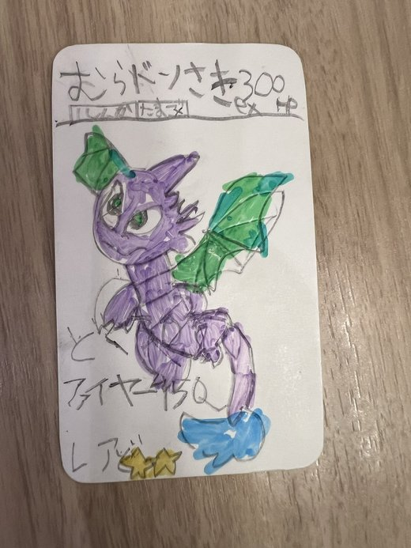
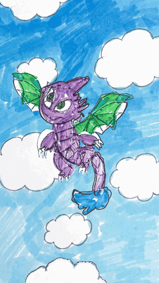
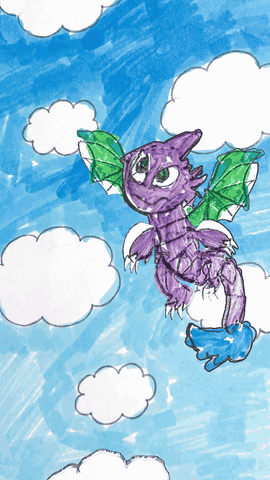
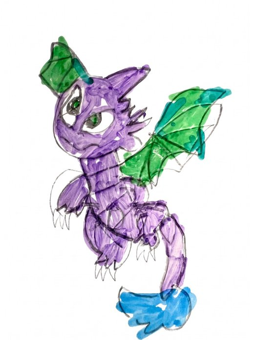
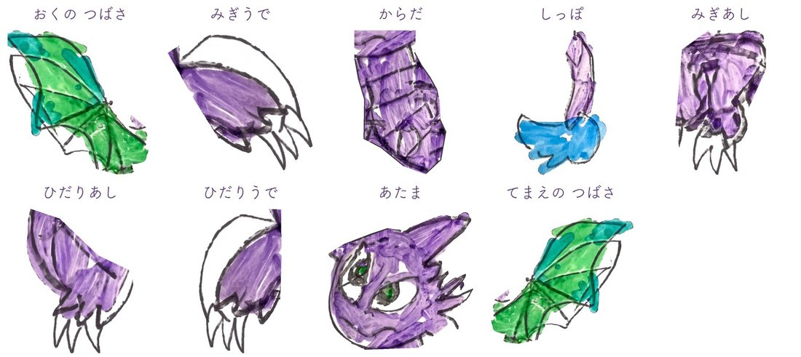
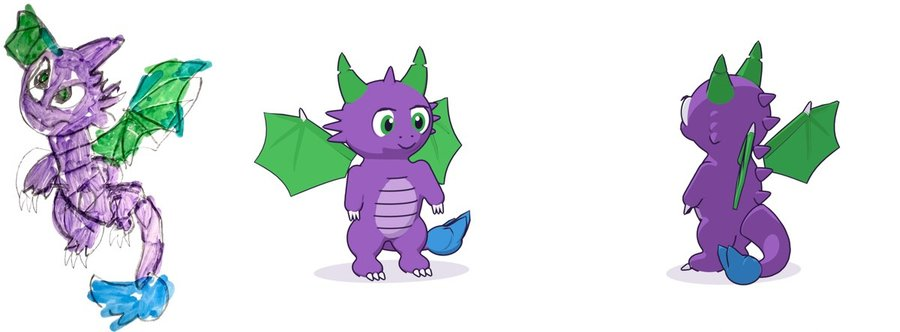

# doodle-to-3d

[日本語](README.md) | **English**

Turn a child's hand drawing (one photo) into a 3D character that **keeps the child's pencil lines and marker
colouring**, then make it fly through a child-drawn sky and breathe fire — with sound effects. Packaged as an agent
skill so **Claude Code, Codex and other coding agents** can reproduce the whole process.

<table>
  <tr>
    <th>The child's card</th>
    <th>Flying</th>
    <th>Breathing fire</th>
  </tr>
  <tr>
    <td></td>
    <td></td>
    <td></td>
  </tr>
</table>

The real output is 1080×1920 (vertical), 24 fps, with wind, wing-flap and fire sounds (the GIFs above are reduced).

## What it does

| | Step | How |
|---|---|---|
| 1 | Extract the character | Straighten the photo; Gemini redraws only the character on white, without "beautifying" the child's lines |
| 2 | Split into parts | Head, body, arms, legs, wings, tail; areas hidden behind other parts are filled with the drawing's own marker strokes |
| 3 | Add what is missing | A far wing or an arm the child did not draw is made by mirroring the drawn one |
| 4 | Make it 3D and move | Each part is puffed up like a plush toy; Blender animates flapping, paddling legs and a waving claw |
| 5 | Sky and fire | Gemini paints a sky and a fire-breath flipbook in the same child-drawn style; the clouds are puffed up too |
| 6 | Sound and video | Wind, wing flaps, an inhale and a fire roar are synthesised and synced to the motion |

<table>
  <tr>
    <th>1. Extracted character</th>
    <th>2–3. Nine parts (far wing and right arm rebuilt by mirroring)</th>
  </tr>
  <tr>
    <td></td>
    <td></td>
  </tr>
</table>

### The point: never erase the child's lines

The first attempt built a clean 3D model from a turnaround sheet. It looked tidy, but every pencil line was gone and
it read as "blocks of colour" (the two images on the right):



So this pipeline uses the original pixels for everything that is visible, and fills hidden or missing areas only with
the child's own strokes (mirrored parts, copied marker texture).

## Scenes

| Mode | Length | What happens |
|---|---|---|
| `swoop` | 15 s | Flies in from below, weaves left and right, climbs out of the frame |
| `hover` | 10 s | Rises in place, flapping |
| `fire` | 11 s | Inhales, then breathes fire from its mouth (the flame is drawn in the child's style too) |

## Requirements

- Python 3.10+
- [Blender](https://www.blender.org/download/) on your `PATH` as `blender` — tested with **Blender 5.2** (Eevee);
  4.x is untested
- [ffmpeg](https://ffmpeg.org/) on your `PATH`
- A **Gemini API key** (image generation): about three image calls per drawing, roughly USD 0.1–0.2 each at the time
  of writing — check current pricing
- macOS, Linux or Windows (developed on macOS)

## Setup

```bash
git clone https://github.com/skyzhao3q/doodle-to-3d-skill.git
cd doodle-to-3d-skill
python3 -m venv .venv && source .venv/bin/activate
pip install -r requirements.txt
# optional, for iPhone photos (HEIC):
pip install pillow-heif
```

### Gemini API key

1. Create a key in [Google AI Studio](https://aistudio.google.com/apikey).
2. Provide it as an environment variable (recommended):
   ```bash
   export GEMINI_API_KEY="your-key-here"
   ```
   or copy `.env.example` to `.env` (in the repo root or the directory you run from) and fill it in.
   `.env` is git-ignored — **never commit your key**, and don't paste it into chats or issues.
3. Optional: `GEMINI_IMAGE_MODEL` to use a different image model (default `gemini-3-pro-image-preview`).

Check everything:

```bash
python3 -c "import cv2, numpy, scipy, PIL, google.genai; print('python ok')"
blender --version
ffmpeg -version | head -1
python3 -c "import os; print('GEMINI_API_KEY set:', bool(os.environ.get('GEMINI_API_KEY')))"
```

## Use it with a coding agent

**Claude Code**: install as a personal skill, then ask e.g. *"Turn the drawing in ~/doodles/dragon.jpg into a flying
3D character"*.

```bash
git clone https://github.com/skyzhao3q/doodle-to-3d-skill.git ~/.claude/skills/doodle-to-3d
```

**Codex** (and other agents): run the agent inside the cloned repository — it reads `AGENTS.md`, which points to
`SKILL.md`. Codex versions with skill support can also load the folder as a skill (e.g. `~/.codex/skills/doodle-to-3d`).

The agent follows `SKILL.md` and **asks you what ambiguous shapes are** (an ear or a wing?) instead of guessing —
children's drawings often need the artist to explain them.

## Run it by hand

```bash
WORK=~/doodles/dragon            # one work directory per drawing, OUTSIDE this repo
mkdir -p $WORK/input && cp photo.jpg $WORK/input/
cp examples/purple-dragon/config.json $WORK/config.json   # start from the example, then edit

python3 scripts/prepare.py $WORK --card          # --card: the drawing is a card/sheet on a table
python3 scripts/gem.py extract $WORK             # Gemini: clean-up (1 image)
python3 scripts/cutout.py $WORK
python3 scripts/grid.py $WORK                    # read coordinates; edit config.json "parts"
python3 scripts/parts.py $WORK                   # check renders/parts_preview.png, parts_sheet.png
python3 scripts/gem.py sky $WORK && python3 scripts/clouds.py $WORK                 # Gemini: sky (1 image)
python3 scripts/gem.py fire $WORK && python3 scripts/fire_frames.py $WORK           # Gemini: fire (1 image)

blender -b -P scripts/flight.py -- $WORK build fire                 # also: swoop, hover
blender -b $WORK/out/flight_fire.blend -P scripts/flight.py -- $WORK render
blender -b $WORK/out/flight_fire.blend -P scripts/sfx_cues.py -- $WORK
python3 scripts/sfx.py $WORK flight_fire                          # add --whoosh for swoop
python3 scripts/make_video.py $WORK flight_fire                   # -> out/flight_fire_sfx.mp4
python3 scripts/freeze.py $WORK v1                                # optional read-only snapshot
```

`config.json` is documented in [docs/CONFIG.md](docs/CONFIG.md). The example config describes a purple dragon drawn on
a trading card; its coordinates only fit that drawing, so treat it as a template.

## Privacy

- The drawing is uploaded to Google's Gemini API for the clean-up, sky and fire steps. Get the artist's (or parent's)
  consent first, and check your Gemini terms regarding data use.
- Keep work directories outside this repository. `.gitignore` excludes images, videos, audio, `.blend` files and
  `.env`, but don't rely on it alone.
- The drawing and GIFs in `docs/images/` are samples published with the author's family's consent.

## Limitations

- Part outlines are written by hand (by you or the agent) per drawing; there is no automatic segmentation.
- The 3D is "puffy layers" built from the drawing, so it looks best within about ±40° of the front view.
- Sound effects are synthesised and simple; listen before you share.
- Rendering takes about 1 s per frame (Eevee, 1080×1920) on a recent laptop.

## License

MIT — see [LICENSE](LICENSE). The sample images in `docs/images/` are for illustration only; please don't reuse
them for other purposes.
